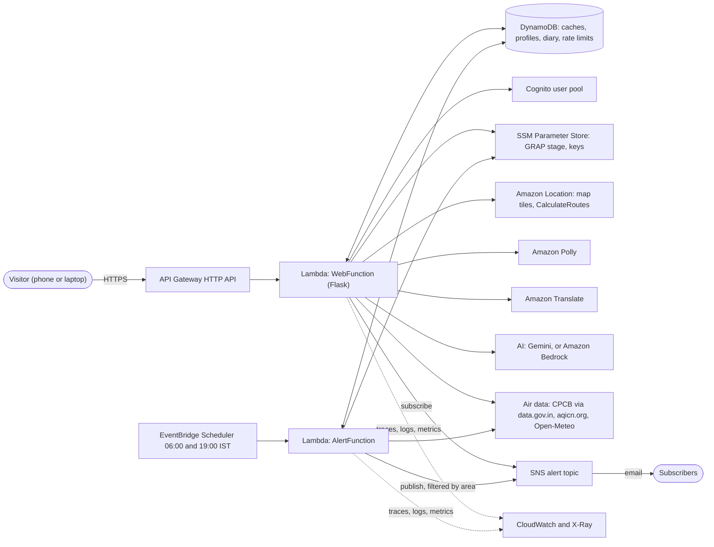
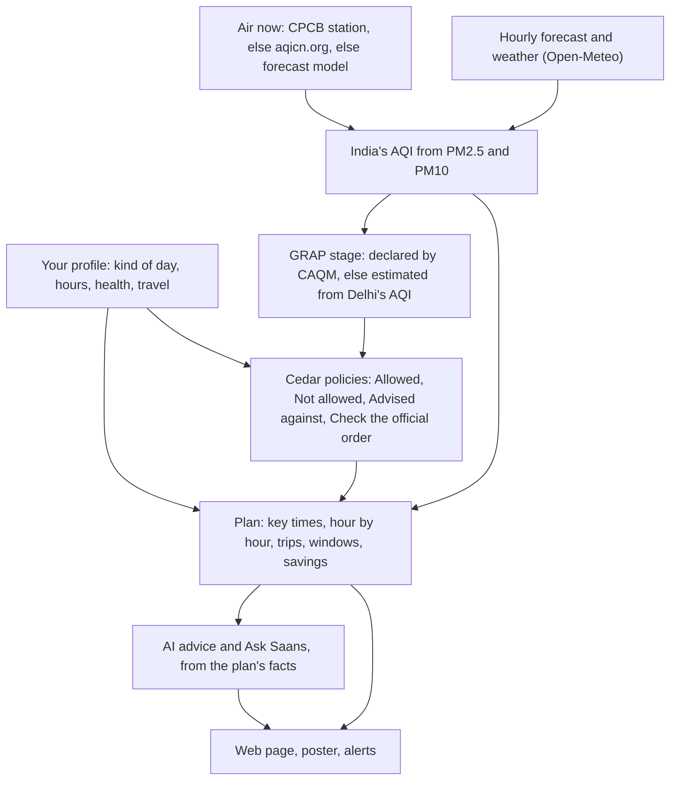

# Saans Compass

**Your air and your day, in one plan.**

Saans Compass turns the air where you live into a plan for your own day in Delhi-NCR. It tells you when to step out and when to stay in, which way to travel, when to open the windows, what your health conditions mean on a bad-air day and what the GRAP rules allow you to do. It works for people who commute and for people who spend the whole day in one place: at home, at school or at work.

**Live:** https://ia0jvsj3of.execute-api.ap-south-1.amazonaws.com/

Our entry for **Environmental Hacks** (Air track), WeMakeDevs x AWS, Bharat Builds Tour, 8–11 Oct 2026. Team Qubits.

> Advisory only. Not medical advice and not an official order. In an emergency, call 112.

## The problem

Every winter Delhi-NCR's AQI climbs into "Very Poor" and "Severe". An AQI number alone doesn't tell a delivery rider when to take a break, a school when to hold assembly indoors, a parent with an asthmatic child when to air the flat, or a driver whether their car is allowed on the road under GRAP. Saans Compass answers those questions for one person at a time, from live station readings, the hourly forecast and the official GRAP schedule.

## What it does

- **A plan for your kind of day.** Describe what you do in your own words ("I deliver food on a scooter at night"). The AI matches it to the closest of 19 kinds of day (student, teacher, office worker, delivery rider, auto driver, street vendor, pregnant, retired and more) and picks out the hours you mention. Without the AI, a keyword match does the same. You can add your age, any of 16 air-related health conditions (asthma, COPD, heart disease, pregnancy, smoking and more), how you travel, your outdoor hours and whether you own an N95. Each condition makes your limits stricter and adds its own "why, what to do, watch for" advice.
- **At a glance.** Your area's AQI and verdict, your key times (best hour, worst hour, when to set out, tomorrow) and a to-do list grouped by timing, getting around, protecting your lungs, home and health. Times that have already passed today are left out.
- **Your day, hour by hour.** Each hour is charted against your own limits. Tap an hour to see its AQI, PM2.5, PM10, weather, your plans in that hour and what to do.
- **Days in one place.** Tick "in one place all day" and the plan drops the commute. It lists each outdoor part of the day (assembly, recess, PE, a walk) at its own hour with its AQI and what to do.
- **Your windows.** A 24-hour strip shows when to open the windows to air the rooms, when to keep them shut and when to run an air purifier, worked out from the hourly AQI and your limits.
- **Your trips and a cleaner route.** "Your trips" shows the air at the start, along the way and at the destination, out and back. Each stop reads its nearest live monitoring station. For trips by road, Amazon Location Service finds alternative routes and the plan compares the air along each one: the AQI at points along the route multiplied by the minutes spent there. Where no station is close, forecast points every 15 km fill the gap. When your usual route's average AQI is above 150 and another route cuts what you breathe by at least 5%, the plan says so ("Take route 2: 18% less pollution than your usual way").
- **What your plan saves you.** The plan estimates how much less PM2.5 you breathe by following it, compared with the same minutes outside at the day's worst hours or at your usual times. Signed in, you can answer "Did you follow today's plan?" and a weekly diary shows the last seven days.
- **GRAP rules, personalised.** The plan shows Delhi-NCR's GRAP stage (as declared by CAQM, or estimated from Delhi's average AQI) and what it means for your activities, your vehicle and the way you travel. Only rules that change your day get a card (**Not allowed**, **Advised against**, **Check the official order**); everything else fits on one line. Each decision comes from a [Cedar](https://www.cedarpolicy.com/) policy and names its clause in the schedule. Anything no verified rule covers says "Check the official order", never "Allowed".
- **Ask Saans.** A chat on the plan page answers from your plan's hourly figures and rules: "When's the best time for a run tomorrow?", "I'm taking my students to Noida by bus", "Can I take my car out?". If a question names a place your plan doesn't cover, the server looks up that place's hourly air and the model answers using it. Each answer ends with up to three follow-up questions you can tap. The chat never overrides a rule decision, never diagnoses, and points emergency symptoms to 112.
- **Hindi and voice.** The English / हिंदी switch translates the whole page. **Speak in Hindi** lets you ask Ask Saans out loud and hear the reply, and the personal advice can be read aloud.
- **Today and tomorrow.** The plan opens on today, with tomorrow one tab away. The dials follow the tab, so the Tomorrow tab shows tomorrow's forecast.
- **Try a different day.** Signed in, you can try another trip or other outdoor hours and see that plan without changing your saved profile.
- **Pollution map.** The home page maps the live AQI at every monitoring station around Delhi, coloured by India's AQI categories. Tap a station to see its name, AQI and reading time.
- **Daily poster and email alerts.** A printable A4 poster or PDF of your plan, with a QR code that carries only the kind of day and the area. Email alerts for Delhi's areas: at 06:00 and 19:00 IST a scheduled check emails subscribers only when their area's plan has changed.
- **Accounts (optional).** Sign up with email and password. Your profile is saved under your account only, never in a link, QR code or log, and is deleted along with your account.

Places within 150 km of Delhi are covered. The limit is one setting (`place_region_km`); set it to `0` to open the app to all of India, in which case places outside Delhi-NCR get a plan without GRAP.

## Built on AWS

Everything runs serverless in **ap-south-1 (Mumbai)** and is defined in a single SAM template, [`template.yaml`](template.yaml).

| AWS service | What it does in Saans Compass |
|---|---|
| **AWS Lambda** (Python 3.12) | `WebFunction` serves every page and the JSON API (Flask through `apig-wsgi`). `AlertFunction` runs the scheduled area checks. |
| **Amazon API Gateway** (HTTP API) | The public URL. Throttled to 20 requests/s with a burst of 50. |
| **Amazon EventBridge Scheduler** | Runs `AlertFunction` at 06:00 (today's plan) and 19:00 (tomorrow's plan), `Asia/Kolkata` time. The hours are deploy parameters. |
| **Amazon SNS** | Area email alerts. Each subscription filters on its area, so people only hear about their own area. A second topic emails the operator when an alarm fires. |
| **Amazon DynamoDB** | One on-demand table with TTL: forecast and station caches, typed places, last alert per area, saved profiles, the weekly diary and per-visitor rate limits. |
| **Amazon Cognito** | Sign-up with an email code, sign-in, password reset. Tokens live in HttpOnly cookies. |
| **Amazon Location Service** | The base map for the pollution map (API key, Maps v2 tiles) and `CalculateRoutes` (Routes v2) for the cleaner-route comparison. |
| **Amazon Polly** | Reads the advice and Ask Saans answers aloud in Indian English and Hindi (voice Kajal). |
| **Amazon Translate** | The whole-page English to Hindi switch, with a built-in dictionary for headings as a fallback. |
| **Amazon Bedrock** (optional) | AI provider option: Amazon Nova through the Converse API, or Claude through the Messages API. See [AI provider](#ai-provider). |
| **AWS Systems Manager Parameter Store** | The declared GRAP stage (`/saans-compass/official-stage`) and API keys as SecureStrings (Gemini, data.gov.in, aqicn.org). |
| **AWS IAM** | One least-privilege role per Lambda. No keys in the code or in GitHub. |
| **Amazon CloudWatch** | Logs kept for 14 days, a dashboard (invocations, errors, p90 duration, forecast outages, API 5xx), an alarm on alert errors and custom metrics for stale forecasts. |
| **AWS X-Ray** | Active tracing on both Lambdas. |
| **AWS Budgets** (optional) | A USD 1 monthly budget with an email warning at 80%. |
| **AWS CloudFormation / SAM** | The whole stack in one template; `sam deploy` builds and ships it. GitHub Actions can deploy through an OIDC role. |

### Architecture



How one plan is built:



## AI provider

Personal advice, Ask Saans and reading your own words run on **Google Gemini** (`gemini-flash-latest`, falling back to a lighter model when the quota runs out). We built Amazon Bedrock in as a first-class option, but Bedrock model access was blocked on our AWS account during the hackathon, so the live site uses Gemini. Switching to Bedrock is one deploy parameter:

```bash
sam deploy --parameter-overrides AiProvider=bedrock BedrockModel=apac.amazon.nova-lite-v1:0
```

Model ids starting with `anthropic.` go through the Anthropic Messages API on Bedrock; any other id, such as Amazon Nova, goes through the Converse API. With `AiProvider=off` the app still works: the plan, rules and alerts never depend on the AI, and a keyword match reads your profile.

## Data sources

| Source | Used for |
|---|---|
| [CPCB](https://airquality.cpcb.gov.in/) live station readings via [data.gov.in](https://data.gov.in/) | "Now" at the nearest station, and Delhi's city AQI for the GRAP estimate |
| [aqicn.org](https://aqicn.org/) (World Air Quality Index project) | Backup for the same stations when data.gov.in is down, the pollution map and stops along trips. Readings are converted to India's AQI from PM2.5 and PM10. |
| [Open-Meteo](https://open-meteo.com/) | Hourly air-quality forecast (PM2.5, PM10), weather, mixing height and geocoding |
| CAQM's GRAP schedule for NCR, Revision 29.09.2026 | The Cedar rules in `src/saans/rules/` |

Air data is cached for 30 minutes. If the forecast is unreachable, the app uses the last real forecast it fetched (up to 48 hours old) and shows a banner. If it has none, it says the forecast is unavailable instead of inventing numbers. The app has no demo data.

## No hardcoding: settings and content live in config

Nothing the app says or decides with is buried in Python. `src/saans/config/` holds:

- `settings.json`: runtime settings such as data sources, timeouts, cache times, the covered region, when GRAP applies, AI models, rate limits and alert hours. **Any key can be overridden by an environment variable with the same name in capitals**, for example `PLACE_REGION_KM=0`.
- Content files: `areas.json`, `aqi.json` (bands), `personas.json` (the 19 kinds of day), `profile.json` (conditions), `explain.json` (GRAP stages and measures), `advice.json`, `glance.json`, `prompts.json` (AI prompts), `chat.json`, `route.json`, `map.json` (map and cleaner-route thresholds), `layout.json` (section order, error messages), `hindi.json` and more.
- `src/saans/rules/*.cedar`: the GRAP rules as policy, one file per group (school, rider, worker, commuter, athlete, older adult, sensitive, travel).

To change content, edit a file and redeploy; no code changes needed. When CAQM revises GRAP, edit the policies and their tests.

Deploy parameters in `template.yaml`:

| Parameter | Default | What it does |
|---|---|---|
| `AiProvider` | `gemini` | `gemini`, `bedrock` or `off` (lowercase) |
| `GeminiModel` | `gemini-flash-latest` | Gemini model id |
| `BedrockModel`, `BedrockRegion` | `apac.amazon.nova-lite-v1:0`, `ap-south-1` | Bedrock model or inference profile, and its region |
| `Grap` | `on` | GRAP stage and rules |
| `Accounts` | `on` | Cognito sign-up and saved profiles |
| `VoiceChat` | `on` | Ask Saans by voice in Hindi |
| `AirMap`, `CleanRoute` | `on` | Pollution map and cleaner route (Amazon Location) |
| `DefaultArea`, `DashboardArea`, `AlertPersonas`, `MorningAlertHour`, `EveningAlertHour` | `anand-vihar`, `ito`, `school,rider,older`, `6`, `19` | Defaults for pages and alerts |
| `BudgetEmail`, `AlarmEmail` | empty | Optional cost budget and alarm emails |

### Which GRAP stage is used

1. The stage stored in Parameter Store, shown as "Declared by CAQM". When CAQM announces a stage, one command updates every page and the next alert run:
   ```bash
   aws ssm put-parameter --overwrite --region ap-south-1 --name /saans-compass/official-stage --value III   # or unset
   ```
2. Otherwise, an estimate from Delhi's city-wide AQI: CPCB's average across Delhi's stations when the feed is up, else the average of the 9 areas' forecasts. GRAP is ordered for all of Delhi-NCR at once, so every NCR place shows the same stage.

Every policy carries `@clause` and `@status("verified")`. Schedule actions become **Not allowed** or **Allowed**; citizen-charter advice becomes **Advised against**; anything the schedule doesn't cover, or a draft rule, says **Check the official order**.

## Project layout

```
src/saans/
  web.py, web_accounts.py   pages and JSON API; lambda_handler.py and alert_handler.py are the Lambda entry points
  service.py                the pipeline: forecast -> AQI -> stage -> rules -> plan
  data.py                   Open-Meteo forecast and geocoding, typed places, last-real-forecast fallback
  cpcb.py, waqi.py          CPCB station AQI from data.gov.in, and the aqicn.org backup
  aqi.py                    India's AQI from PM2.5 and PM10
  stage.py, rules.py        GRAP stage, and Cedar evaluation of the rules
  advisor.py, guide.py      hour-by-hour plan, best window, verdict, "At a glance"
  saving.py, dose.py        what following the plan saves, the weekly diary, and the breath dose
  windows.py                windows and air purifier planner
  personas.py, profile.py   the 19 kinds of day; age, conditions, travel and hours
  route.py, cleanroute.py   places and trips; Amazon Location routes and the air along each
  airmap.py                 station AQIs for the pollution map
  ai.py                     advice, chat and reading your words (Gemini or Bedrock), Polly voice
  i18n.py                   English to Hindi: built-in dictionary, then Amazon Translate
  alerts.py                 per-area change detection, SNS publish and subscribe
  accounts.py, store.py     Cognito sign-in; DynamoDB storage
  settings.py               reads config/, with environment-variable overrides
  config/                   settings and all content (see above)
  rules/                    schema.cedarschema and the .cedar policies
  templates/, static/       Jinja pages, CSS and the map script
tests/                      pytest suite, AWS mocked with moto
```

Pages and API: `/`, `/plan`, `/poster`, `/account`, `/account/profile`, `GET /api/plan`, `GET /api/summary`, `POST /api/chat`, `GET /api/speak`, `POST /api/translate`, `GET /api/places`, `GET /api/map/stations`, `GET /api/routes`, `POST /api/locate`, `POST /diary`, `POST /subscribe`, `/healthz`.

## Run locally and test

```bash
python3.12 -m venv .venv && . .venv/bin/activate
pip install -r requirements-dev.txt
pytest -q                                            # 472 tests, AWS mocked
cd src && flask --app "saans.web:create_app()" run   # http://127.0.0.1:5000
```

Without AWS variables the app uses an in-memory store, and the AI, accounts and alerts are turned off. GitHub Actions runs the tests and `cfn-lint` on every push.

## Deploy (ap-south-1)

You need the AWS CLI, the SAM CLI and Python 3.12. On Windows, follow [DEPLOY_WINDOWS.md](DEPLOY_WINDOWS.md); it also shows how to store the API keys in Parameter Store without pasting them anywhere. [AWS_SETUP.md](AWS_SETUP.md) lists what the AWS account needs.

```bash
# once: store the keys as SecureStrings (the Gemini key is needed for AiProvider=gemini; the others are optional)
aws ssm put-parameter --region ap-south-1 --type SecureString --name /saans-compass/gemini-api-key --value <key>
aws ssm put-parameter --region ap-south-1 --type SecureString --name /saans-compass/datagov-api-key --value <key>
aws ssm put-parameter --region ap-south-1 --type SecureString --name /saans-compass/waqi-token --value <token>

sam build
sam deploy --guided        # stack saans-compass, region ap-south-1, AiProvider gemini
```

The `SiteUrl` output is the public URL. To run an alert check on demand:

```bash
sam remote invoke AlertFunction --stack-name saans-compass --event-file events/today.json
```

GitHub Actions can also deploy from `main` through an IAM role trusted by GitHub's OIDC provider (repository variable `AWS_DEPLOY_ROLE_ARN`), so no AWS keys are stored in GitHub.

## Privacy

- Without an account, your profile lives only in the page link and is not stored. Signed in, it is saved under your account only. Health details and "About me" are sent to the AI model for the advice, and are never logged or put in a QR code.
- Live-location coordinates are used for one answer only and are never stored, logged or put in a link. Typed places are kept as rounded coordinates under a hashed id for 90 days.
- Chat questions are never logged. To rate-limit chat and translation per visitor, the IP address is kept as a hash for an hour, then deleted.

## Honest limits

- When no station reading is available, the AQI comes from a forecast model (about a 40 km grid), which can be far from what a ground station measures, especially for dust.
- The "this hour" figure is an estimate, because India's AQI is defined on 24-hour averages.
- The GRAP stage is an estimate unless CAQM's declared stage is stored in Parameter Store. Delhi-NCR is taken as within 150 km of Delhi, which is close to but not exactly the official boundary.
- Advice and chat answers are written by a language model from the plan's facts; the rule decisions shown beside them are the source of truth.
- Activity thresholds, breathing dose and the savings estimate are our own heuristics, not medical advice. Savings assume indoor PM2.5 at 70% of outdoor (`indoor_pm25_ratio`) and leave masks out.

## Credits

Advice by risk group inspired by Canada's AQHI; the cleaner-time idea from London's Clean Air Routes; school flags from the US School Air Quality Flag Program; policy as code with Cedar; forecast, weather and geocoding from [Open-Meteo](https://open-meteo.com/) (CC BY 4.0); station data from CPCB via data.gov.in and the World Air Quality Index project.

## License

MIT
